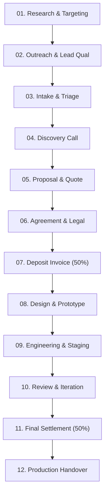

# ShivamWebDesigns — End-to-End Business Workflow

This document codifies the complete 12-stage customer journey at **ShivamWebDesigns (SWD)**, covering every milestone from cold market research to post-launch client retention.

---

---

## The 12-Stage Lifecycle Breakdown

### Stage 1: Market Research & Lead Discovery
- **Action:** Identify active businesses, startups, and personal brands with outdated websites, poor mobile UI, slow load times, or no modern digital presence.
- **Tools:** [`02-CLIENT-ACQUISITION/CLIENT-RESEARCH-CHECKLIST.md`](../02-CLIENT-ACQUISITION/CLIENT-RESEARCH-CHECKLIST.md)
- **Gate:** Lead must have verifiable contact coordinates and a clear, measurable problem we solve.

### Stage 2: Personalized Outreach & Lead Qualification
- **Action:** Send tailored, non-spammy outreach messages via LinkedIn, Instagram, or Email pointing out one genuine opportunity.
- **Tools:** [`02-CLIENT-ACQUISITION/OUTREACH-SYSTEM/`](../02-CLIENT-ACQUISITION/OUTREACH-SYSTEM/) & [`LEAD-TRACKER-TEMPLATE.csv`](../02-CLIENT-ACQUISITION/LEAD-TRACKER-TEMPLATE.csv)
- **Rule:** Never use false urgency, generic compliments, or unsolicited attachments. Follow up once after 3–5 business days.

### Stage 3: Intake & Project Scoping
- **Action:** When a lead expresses interest, direct them to review the agency profile or submit the project inquiry form.
- **Tools:** [`03-GOOGLE-WORKSPACE/CLIENT-INQUIRY-FORM.md`](../03-GOOGLE-WORKSPACE/CLIENT-INQUIRY-FORM.md)
- **Output:** Completed project brief containing budget tier, target deadline, and primary business goals.

### Stage 4: Discovery Session
- **Action:** 20–30 minute structured video call via Google Meet to diagnose technical requirements, aesthetic vision, and functional scope.
- **Tools:** [`05-MEETINGS/CLIENT-MEETING-AGENDA.md`](../05-MEETINGS/CLIENT-MEETING-AGENDA.md) & [`DISCOVERY-QUESTIONS.md`](../05-MEETINGS/DISCOVERY-QUESTIONS.md)
- **Output:** Documented meeting notes and confirmation email within 24 hours.

### Stage 5: Proposal & Quotation Delivery
- **Action:** Present an itemized Scope of Work (SOW), deliverables, timeline, milestones, and transparent pricing.
- **Tools:** [`06-PROPOSALS-AND-QUOTATIONS/PROJECT-PROPOSAL.md`](../06-PROPOSALS-AND-QUOTATIONS/PROJECT-PROPOSAL.md) & [`QUOTATION-TEMPLATE.md`](../06-PROPOSALS-AND-QUOTATIONS/QUOTATION-TEMPLATE.md)
- **Standard Milestone:** 50% upfront commitment deposit, 50% upon final sign-off prior to DNS cutover.

### Stage 6: Legal Protection & Contract Execution
- **Action:** Execute the mutual Master Services Agreement and optional Non-Disclosure Agreement (NDA).
- **Tools:** [`07-LEGAL-DOCUMENTS/SERVICE-AGREEMENT-TEMPLATE.md`](../07-LEGAL-DOCUMENTS/SERVICE-AGREEMENT-TEMPLATE.md)
- **Advisory:** Note legal guardian advisory clauses for contracts involving minor founders under 18 until majority is achieved.

### Stage 7: Invoicing & Kickoff Commitment
- **Action:** Issue Pro-Forma Invoice for Milestone 1 (50% upfront deposit).
- **Tools:** [`08-FINANCE/INVOICE-TEMPLATE.md`](../08-FINANCE/INVOICE-TEMPLATE.md) & [`PAYMENT-PROCESS.md`](../08-FINANCE/PAYMENT-PROCESS.md)
- **Gate:** Work commences ONLY after confirmed bank/UPI settlement of the initial deposit.

### Stage 8: Client Onboarding & Welcome Kit Dispatch
- **Action:** Send formal Welcome Letter, project schedule, communication channel links, and onboarding questionnaire.
- **Tools:** [`04-CLIENT-WELCOME-KIT/`](../04-CLIENT-WELCOME-KIT/)
- **Output:** Client provides brand assets, copy, logos, credentials, and reference material via a secure shared drive.

### Stage 9: Design & Prototyping
- **Action:** High-fidelity interactive prototypes (Figma), editorial typography pairings, and spatial UI architecture.
- **Milestone:** Client approves design direction before full code implementation begins.

### Stage 10: Production Engineering & Staging
- **Action:** Clean semantic Next.js 15 / TypeScript development, responsive layout tuning, and Vercel edge staging deployment.
- **Tools:** [`09-PROJECT-MANAGEMENT/PROJECT-STATUS-UPDATE.md`](../09-PROJECT-MANAGEMENT/PROJECT-STATUS-UPDATE.md)
- **Verification:** 100/100 Core Web Vitals, mobile viewport fluid scaling, WCAG AA contrast.

### Stage 11: Review, Structured Revisions & Final Settlement
- **Action:** Client audits staging build. Up to two formal revision cycles executed.
- **Tools:** [`09-PROJECT-MANAGEMENT/REVISION-REQUEST.md`](../09-PROJECT-MANAGEMENT/REVISION-REQUEST.md) & [`CLIENT-APPROVAL-TEMPLATE.md`](../09-PROJECT-MANAGEMENT/CLIENT-APPROVAL-TEMPLATE.md)
- **Milestone 2:** Client executes written sign-off and settles remaining 50% balance.

### Stage 12: Production Launch, Handover & Retention
- **Action:** DNS configuration, custom domain mapping, code asset transfer, credentials transfer, and warranty commencement.
- **Tools:** [`10-DELIVERY-AND-HANDOVER/`](../10-DELIVERY-AND-HANDOVER/)
- **Retention:** Post-launch satisfaction feedback collected; ongoing maintenance retainer offered.
